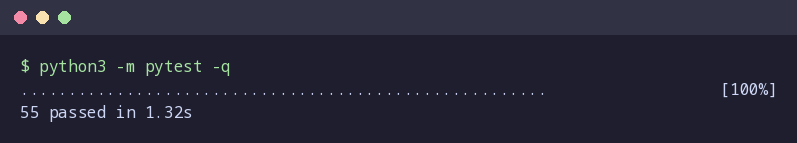
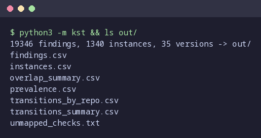
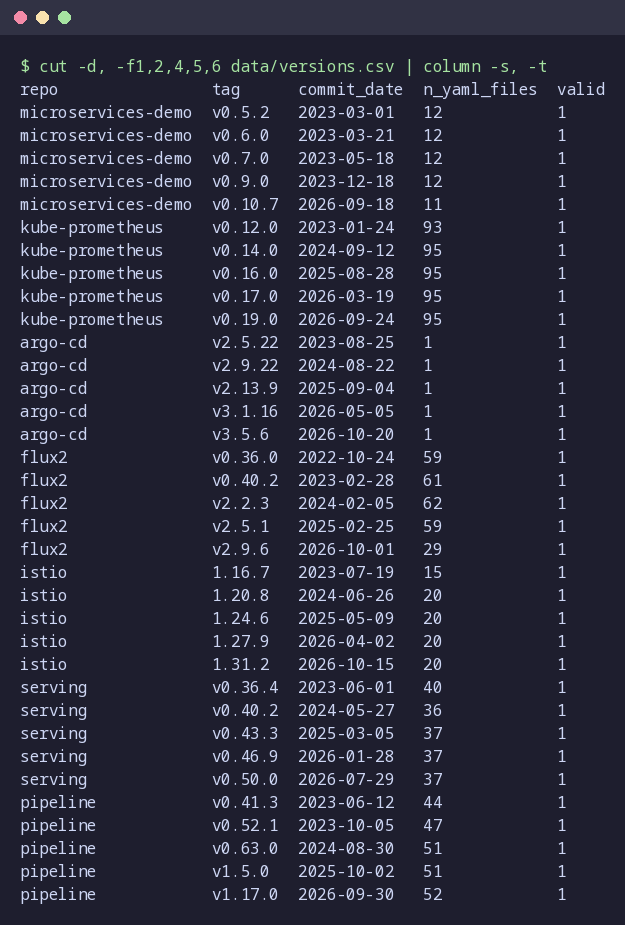
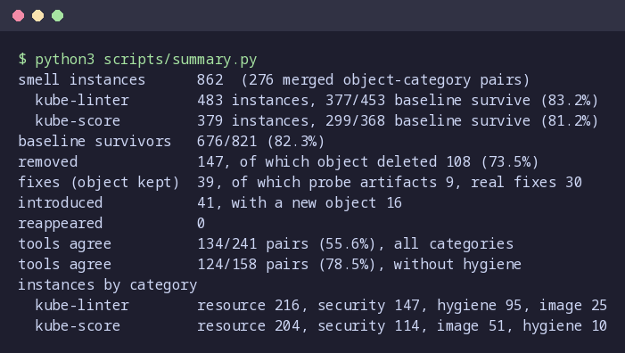
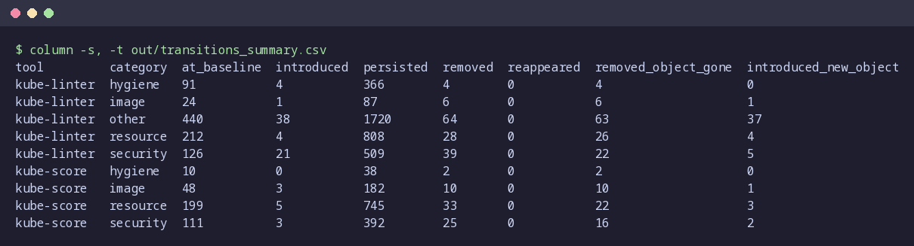
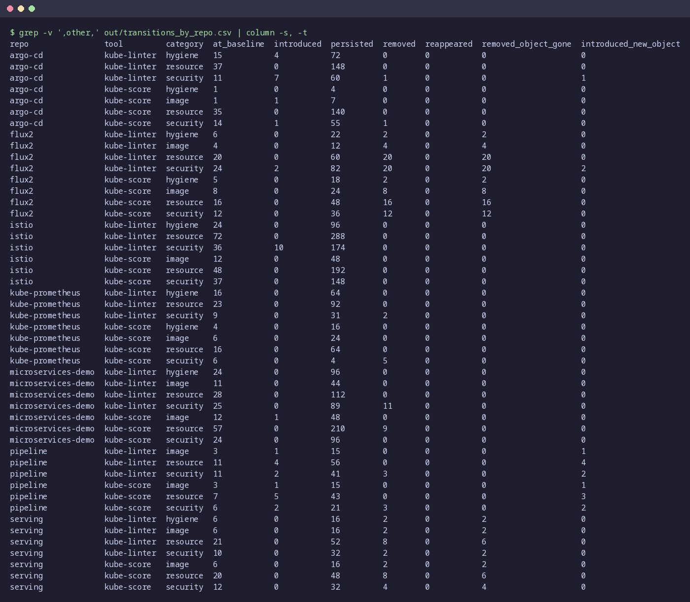
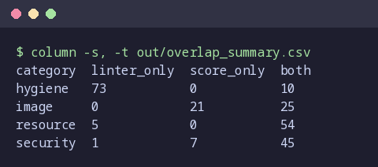
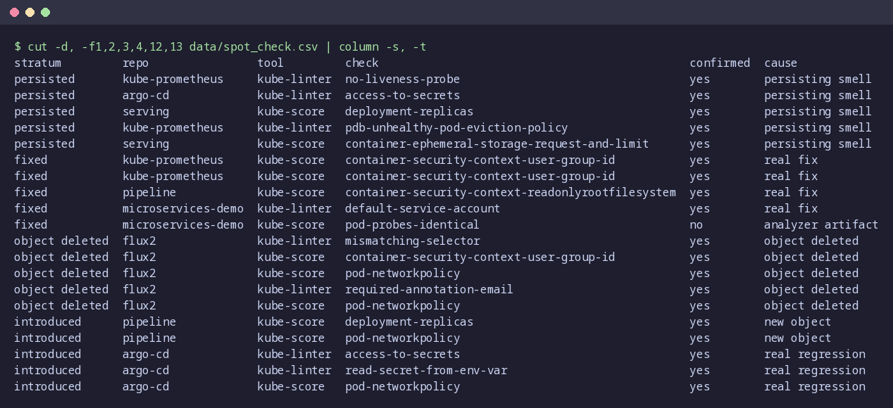
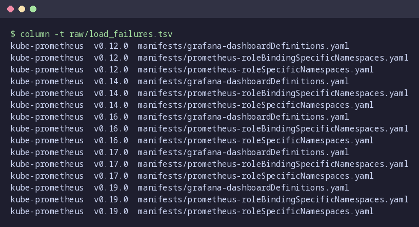

# Results

Screenshots of the Milestone 2 results, taken from the committed outputs in `out/`, `data/` and
`raw/`. Each image is the real output of the command shown at its top, captured by
`results/render.py`. [commands.md](commands.md) lists every command used to produce the data
and the images.

Smell counts below leave out the "other" category (style checks, opinionated defaults and
kube-linter's example ownership policies). Counts are per tool unless a line says merged: a
problem both tools flag is two instances.

## 1. Tests

All 55 unit and pipeline tests pass.

## 2. Analysis run

`python3 -m kst` reads the committed `raw/` analyzer output and writes the tables in `out/`:
19,346 analyzer reports, 1,340 tracked instances (including "other") over 35 release tags.
`unmapped_checks.txt` is empty, so every check seen has a category.

## 3. Study systems and tags

Seven repositories, five release tags each, spread over four years of minor releases. All 35
tags are valid (`valid = 1`): both analyzers produced well-formed output and manifests were
found at every tag.

## 4. Headline numbers

- **862 smell instances** (483 kube-linter, 379 kube-score) on 276 distinct object–category pairs.
- **Smells persist:** 676 of the 821 smells present at the first tag (82.3%) are still there at the last tag.
- **Removals are mostly deletions:** 108 of 147 removals (73.5%) happen because the whole object was deleted, not because the smell was fixed.
- **Few real fixes:** 39 removals kept the object. 9 of them are a kube-score artifact: kube-score stops comparing probes once they use grpc, which happened in microservices-demo v0.9.0. That leaves 30 real fixes.
- **Introductions:** 41, of which 16 arrived together with a new object. No smell reappeared after being removed.
- **Tool agreement:** both tools flag the same object in the same category in 134 of 241 pairs (55.6%), and 124 of 158 (78.5%) without hygiene.
- **Prevalence:** resource is the most common category for both tools, then security.

## 5. Transitions by tool and category

Instance counts summed per tool and category. `removed_object_gone` is the part of `removed`
where the object no longer exists; `introduced_new_object` is the part of `introduced` that came
with a new object.

## 6. Transitions by repository

The same counts per repository ("other" rows hidden). 84 of the 147 removals are in flux2, and
all 84 are object deletions.

## 7. Tool overlap

Distinct (repo, object, category) pairs flagged by kube-linter only, kube-score only, or both
at the same tag. Only the object kinds kube-score scores are compared (kube-score never scores
RBAC objects).

## 8. Manual spot-check

20 instances drawn with a fixed seed, 5 per stratum, each checked by reading the YAML at both
tags. 19 were confirmed. The one rejected "fix" is the kube-score probe artifact described in
section 4.

## 9. Files kube-linter could not load

Three kube-prometheus files (`kind: List`) fail to load at all five tags. They are logged rather
than analyzed. Because they fail at every tag, they cannot create false fixes or introductions.
